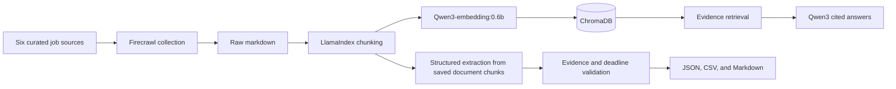

# Private Research Assistant

A CLI research assistant for discovering AI/ML PhD advertisements from curated Europe/UK sources, extracting fields with source references, and answering questions over a local vector index.

Hosted Firecrawl collects public pages. Ollama runs Qwen3 and qwen3-embedding:0.6b embeddings locally; LlamaIndex handles chunking and retrieval, and ChromaDB stores the vector index. Python validators check extracted excerpts, deadlines, and answer citation IDs.

## Architecture



Raw crawl data and the vector database stay on the local machine and are excluded from Git. Firecrawl is the only hosted component in the current workflow.

## Capabilities

- Collect public web evidence from curated sources.
- Parse and index retrieved text.
- Extract structured opportunities with citations.
- Generate answers using retrieved context and check returned citation IDs.
- Check that extracted values match normalized excerpts in cited chunks.

Unsupported values become `unknown`. Unsupported page formats are skipped by default.

## Setup

Requires Python 3.12+, uv, and Ollama for the live RAG path.
The tests run without an API key or model download after installing dependencies.

```bash
uv venv
uv sync
cp .env.example .env
```

Edit `.env` and add your Firecrawl API key.

Model settings follow one order: the process environment overrides `.env`,
and `.env` overrides defaults in `config.py`. Blank model names are rejected;
outer spaces are removed. `load_dotenv` loads `.env` into the process environment
without replacing existing values. Restart the command after editing `.env`;
in a long-running Python session, previously loaded values remain until cleared.
`setup-check`, `index`, and `ask` use the same settings. The disk check is a
minimum free-space check, not a guarantee that new model downloads will fit.

Changing the embedding model requires rebuilding the index before asking questions.
`pra ask` rejects a different model name rather than comparing incompatible vectors.
The check tolerates outer spaces and an omitted `:latest` tag; it does not verify
model file contents. It never rebuilds or deletes data automatically.

Pull the two local models:

```bash
ollama pull qwen3:1.7b
ollama pull qwen3-embedding:0.6b
```

Then check readiness:

```bash
uv run pra setup-check
```

## Workflow

```bash
uv run pra crawl
uv run pra index
uv run pra extract
uv run pra ask "Which active AI PhD opportunities are fully funded?"
```

To extract and validate an existing indexed crawl:

```bash
uv run pra extract
uv run pra inspect opportunities
```

To inspect saved artifacts and retrieved context:

```bash
uv run pra inspect raw --limit 3
uv run pra inspect chunks --query "fully funded" --limit 3
uv run pra ask --show-context "Which active AI PhD opportunities are fully funded?"
```

For a repeatable local test that does not use Firecrawl or Ollama:

```bash
uv run python -m unittest discover -s tests
```

## CLI Commands

- `pra setup-check` checks Python, disk space, Ollama, required models, Firecrawl key, and AI dependencies.
- `pra crawl` searches the six curated public sources and stores raw markdown locally.
- `pra index` chunks the raw crawl output and indexes it into ChromaDB with local Ollama embeddings.
- `pra extract` produces an opportunity table using a structured parser for supported advert pages. The experimental `--llm-fallback` option enables local model extraction for other pages.
- `pra ask "<question>"` retrieves evidence and answers with chunk/source citations.
- `pra inspect raw|chunks|opportunities` displays saved pipeline artifacts.

`eval`, `demo`, and `status` are no longer CLI commands. The test suite includes
the ten saved-answer fixture checks and synthetic extraction cases. `extract`
still checks textual support and deadlines before saving results; `inspect`
lets you read the saved results. These checks are not a RAG accuracy benchmark.

## Data Flow

1. `pra crawl` asks Firecrawl to search the curated source sites and save page text under `data/raw/`.
2. `pra index` splits that text into smaller chunks, gives each chunk an evidence id, embeds each chunk with Ollama, and stores the vectors in ChromaDB.
3. `pra ask` embeds your question, retrieves similar chunks from ChromaDB, and gives only those chunks to Qwen3.
4. `pra extract` reads the indexed chunks and fills a structured opportunity table from known page formats, with optional Qwen3 fallback for harder pages.
5. Extraction retains only values matching normalized text in cited chunks (URLs may match source metadata or links). Other values become `unknown`; rows without a supported title are excluded.
6. The test suite compares saved fixture answers with expected values and references, and tests extraction on synthetic adverts.

## Evaluation Results

The saved crawl dated 2026-09-04 contains 37 documents and 375 evidence chunks.
Re-extraction on 2026-09-05 returned 2 opportunities with matching source excerpts,
active as of the crawl date. All 28 unit tests and 10/10 saved-answer fixture
consistency checks passed. Synthetic extraction tests execute the actual parser
and validator. These results do not measure overall RAG answer accuracy.

A local smoke check on 2026-09-05 retrieved the Newcastle advert as the top
result and returned its stated GBP 21,805 allowance plus 100% home fees with a
matching citation. Manual review confirmed the funding excerpt but found
additional sentences without individual citations. This single check does not
establish end-to-end answer accuracy.

Example extracted rows:

| Title | Institution | Country | Deadline | Funding |
| --- | --- | --- | --- | --- |
| PhD Scholarship in Human Navigation, Artificial Intelligence and Neuroscience for Human-Centric Urban Mobility | Technical University of Denmark | Denmark | 15th September 2026 | Based on Danish collective agreement; open to UK, EU, and international students |
| PhD Studentship in Computer Science: Policy-Compliant Secure AI | Newcastle University | unknown | 10th October 2026 | £21,805 tax-free annual living allowance plus 100% home fees covered |

## Current Limitations

- Textual support checks verify excerpt presence, not factual truth or whether an excerpt refers to the correct vacancy. Review original adverts before applying.
- Answer checks require citations and reject IDs outside retrieved context; they do not verify every claim's meaning. Unverified answers are withheld with a clear message.
- Missing/rolling deadlines are allowed by policy, not confirmed open. Invalid deadlines are excluded. Results describe crawl-date snapshots, not current availability.
- Countries require explicit country text. Source selection targets Europe/UK but does not guarantee geographical coverage or completeness.
- Shortened context and small local models can miss relevant evidence. Optional LLM extraction remains experimental.
- The reliable structured extractor currently targets clean `jobs.ac.uk` advert pages. Other source formats are collected and searchable but often skipped during table extraction.
- Firecrawl collection requires a hosted API key, although model inference, embeddings, indexing, retrieval, and evaluation run locally.
- Saved-answer fixture checks do not establish the accuracy or freshness of live advertisements.
- Re-indexing the same run replaces its existing collection. A failed rebuild may require another `pra index`; rebuilding is not transactional.

## Development

Run the tests with `uv run python -m unittest discover -s tests -v`.
Index integration tests use a temporary Chroma database and fake embeddings;
they check library integration, not semantic retrieval accuracy. They skip when
the AI dependencies are absent. Tests do not require Firecrawl or Ollama calls.

Unexpected library and programming errors retain their Python tracebacks.
Expected failures such as missing saved data, network errors, and malformed
model output have targeted handling. `pra setup-check` reports missing
dependencies; model creation no longer repeats that check. Extraction requires
a valid crawl date in its saved manifest instead of substituting today's date.

## Curated Sources

The first version searches:

- jobs.ac.uk
- FindAPhD
- EURAXESS
- Academic Positions
- ELLIS jobs
- PhD Scanner

Collection is restricted to these configured sources; coverage depends on source availability and page format.

## Data Policy

Live crawl data, Chroma indexes, model files, credentials, generated outputs, caches, and local notes are excluded from Git. The repository contains source code, synthetic demo inputs, evaluation fixtures, tests, documentation, and dependency metadata.

## Repository Layout

```text
src/private_research_assistant/
  cli.py                    Command entry points
  config.py                 Settings, .env loading, and Ollama model setup
  sources.py                Source sites and search queries
  crawl.py                  Firecrawl requests and saved public pages
  indexing.py               Chunk, embed, and store evidence
  retrieval.py              Retrieve chunks and answer with citations
  extraction.py             Produce evidence-backed opportunity rows
  structured_extractors.py  Parse supported advert formats
  models.py                 Opportunity fields and data conversion
  evidence.py               Citation and excerpt checks
  dates.py                  Deadline parsing and filtering
  inspection.py             Display saved data
  paths.py                  Local data locations
  setup_check.py            Check dependencies and local readiness
  demo.py                   Shared synthetic advert chunks for tests
tests/                       Unit tests for the evidence pipeline
  test_evaluation.py        Ten saved-answer fixture consistency checks
```

## Future Work

Version 0.1 uses explicit CLI stages. Planned extensions include autonomous tool
selection with execution traces and stopping criteria, additional source parsers,
and an end-to-end retrieval and answer evaluation set.

## License

Released under the MIT License.
